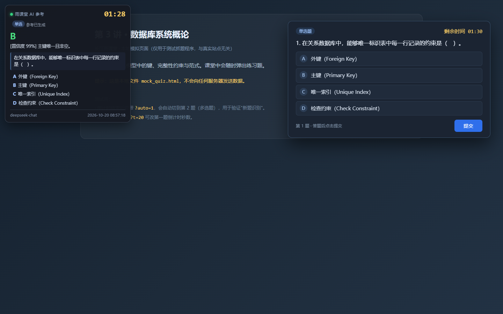

# 雨课堂 AI 参考助手

上课时自动盯（长江）雨课堂网页版的随堂题：认出题型 / 题干 / 选项 / 剩余时间 → 调大模型出参考答案 → 显示在网页浮层和日志里；可选自动填选项、自动提交。

真实随堂题大多是一张 PPT 截图，DOM 里连 A/B/C/D 都没有。脚本用 **Windows 自带 OCR**（`Windows.Media.Ocr`，不需要 tesseract / PaddleOCR）把图里的题干和选项还原成文字，再和页面上的圆钮按钮对齐。

> 定位是「第二双眼睛」：默认只看不碰，不点你的选项、不提交。请遵守课堂纪律和学校规定，使用后果自负。



## 特性

- **双路识别**：DOM 里真有文字就直接读；只有图片时截图 + OCR，两条路互为兜底。
- **认出才算题**：必须识别出题型且至少两个选项才提示，正常讲课的幻灯片不会被误判。
- **不帮倒忙的自动作答**（默认关闭）：只点当前这道题的按钮、页面已有选择就跳过、缺一个选项就只填不交、提交按钮不在题目容器里也能找到。
- **答案缓存在本地**：同一道题再次出现秒出答案。
- **零第三方 OCR 依赖**：只用 Windows 自带识别引擎，中英文混排、折行、`L oa d` 这类拆字都会拼回去。
- 两个版本：浏览器版（有浮层、可自动填）和 HTTP 版（不开浏览器、省资源）。

## 两个版本

| 版本 | 入口 | 需要浏览器 | 适合 |
| --- | --- | --- | --- |
| **浏览器版** | `ykt_watcher.py` | 要一个 Edge 窗口 | 想要浮层、自动填选项 / 提交 |
| **HTTP 版** | `ykt_http.py` | 不用 | 后台常驻、最省资源，见 [`README_HTTP.md`](README_HTTP.md) |

两个版本共用 `ykt_llm.py`（模型调用）和 `ocr_win.py`（OCR）。

## 目录结构

```
雨课堂/
├─ ykt_watcher.py          浏览器版主程序（抓题 / 浮层 / 自动作答）
├─ ykt_llm.py              模型调用与答案解析
├─ ocr_win.py              Windows OCR 封装 + 题目文字解析
├─ win_ocr.ps1             OCR 的 PowerShell 脚本（由 ocr_win.py 自动同步）
├─ mock_quiz.html          文字题模拟页（--mock 用）
├─ mock_image.html         图片题模拟页（单独验证 OCR 用）
├─ ykt_http.py             HTTP 版主程序
├─ ykt_api.py              HTTP 版兼容入口
├─ ykt_http_menu.py        HTTP 版双击菜单
├─ 启动雨课堂助手.bat        浏览器版双击菜单
├─ 启动雨课堂HTTP版.bat      HTTP 版双击入口
├─ 设置APIKey.bat           配模型 Key（双击粘贴，写进本机 config.json）
├─ config.example.json     配置样例（复制成 config.json 后改）
├─ requirements.txt        浏览器版依赖
├─ requirements-http.txt   HTTP 版依赖
├─ tools/
│  └─ set_api_key.py       设置 Key 的命令行脚本（bat 只是包装）
├─ docs/
│  ├─ api-key.md           怎么配 Key：三种存法、换服务商、报错对照
│  ├─ architecture.md      实现说明：链路、抓题策略、踩过的坑
│  └─ overlay-demo.png     浮层效果图
└─ tests/
   ├─ test_dom.py          抓题 / 答案绑定 / 点击提交（18 项）
   ├─ test_ocr.py          编码、圆钮、页脚按钮等 OCR 解析（12 项）
   ├─ test_llm.py          Key 优先级 / 配置读写（9 项）
   └─ test_http.py         HTTP 版（需要 requirements-http.txt）
```

运行时才会生成（都已在 `.gitignore` 里）：`edge_profile/`（登录态）、`ykt_state.json`（HTTP 版登录态）、`shots/`（抓题截图）、`dump/`（现场快照）、`ykt_watch.log`、`answers.jsonl`、`config.json`。

## 环境要求

- Windows 10 / 11（图片题 OCR 依赖系统自带的 `Windows.Media.Ocr`）
- Python 3.10+
- Microsoft Edge（脚本用 `channel="msedge"` 启动，不需要 `playwright install` 下载浏览器）

## 安装

```powershell
cd 雨课堂
python -m pip install -r requirements.txt

# 可选但强烈建议：配一把模型 Key（也能直接双击 设置APIKey.bat）
python tools\set_api_key.py
```

Key 的三种存法、换服务商、报错对照都在 [`docs/api-key.md`](docs/api-key.md)。

## 快速开始（浏览器版）

```powershell
# 0. 配 Key（一次就够；没有 Key 也能跑到第 2 步，只是不出答案）
python tools\set_api_key.py

# 1. 扫码登录一次，登录态存进 edge_profile\
python ykt_watcher.py --login

# 2. 盯 45 分钟
python ykt_watcher.py --duration 45

# 3. 只在某节课的时间窗内盯（到点自动退出）
python ykt_watcher.py --window 14:00-15:40

# 4. 顺手把选项点上（--auto-submit 才会真的提交）
python ykt_watcher.py --window 14:00-15:40 --auto-fill --auto-submit
```

不想敲命令就双击 **`启动雨课堂助手.bat`**（菜单：登录 / 定时监控 / 时间窗口 / 模拟测试 / 调试快照）。

`--window` 也接受 `8:00~9:40`、`08:00到09:40`，跨零点用 `--window 23:30-00:30`。

### 本地自测（不用登录、不联网）

```powershell
python ykt_watcher.py --mock --duration 2                  # 完整流程（含浮层）
python ykt_watcher.py --mock --once --headless             # 只验证抓题
python ykt_watcher.py --mock --mock-query "t=20&auto=1"    # 20 秒后自动切第 2 题（多选）
```

> `--mock`、`--once`、`--dump` 和正式监控共用同一份 `edge_profile\`，不能和正在跑的实例同时开。

## 它怎么工作

完整链路和实现细节见 [`docs/architecture.md`](docs/architecture.md)，这里只讲用户视角：

1. **找课**：带你已登录的 Cookie 调 `GET /api/v3/classroom/on-lesson`，有课在播就直接打开 `https://changjiang.yuketang.cn/lesson/fullscreen/v3/<lessonId>`，不靠猜按钮；没有课就打印提示等着。
2. **抓题**：每 2.5 秒（可配）扫一遍页面所有 frame，按「题型词 / 选项数 / 提交按钮 / 倒计时」给候选容器打分；文字题直接读 DOM，图片题截「正在放映的大图」走 OCR。
3. **出答案**：后台异步调模型，题目先显示、答案后到；同一道题按 `signature` 缓存。
4. **提示**：网页右上角浮层显示状态、倒计时（≤60 秒变红）、题型、参考答案、置信度与理由；剩余 120/60/30 秒时响提示音。
5. **可选自动作答**：把参考答案点到页面对应的圆钮上，`--auto-submit` 时再点提交。

## 浮层怎么用

- 深色卡片：状态点（灰=等题、黄=生成中、绿=有答案、红=出错）+ 倒计时 + 题型 + 参考答案大字 + 置信度/理由 + 题干 + 选项（命中项绿色高亮）。
- 首次出现会自动避开题目面板；按住标题条可拖动，双击复位（位置记在 localStorage）。
- 倒计时每秒刷新；换题自动清空旧答案。

## 自动作答的规则

默认只看不碰。开启后（`--auto-fill`）也仍然保守：

- 单选点一个、多选逐个点（间隔 `fill_gap` 秒）、判断题点「正确/错误」；
- 只点**这道题**的按钮（抓题时已打锚点），不会误点别的题；
- 页面上已有选择就跳过，绝不覆盖你手选的答案；
- 同一题只自动作答一次，轮询不会反复点；
- 有选项没点成功、或找不到提交按钮 → 只填不交，并在日志里说明；
- 图片题要求 OCR 出的标签和网页按钮完全对应才点；只有文字、没有按钮时不点；
- 填空、简答不自动填（键盘输入不可控）；
- `--auto-submit` 只在填入成功后点提交，**会真的计分**。

## 参数

| 参数 | 说明 |
| --- | --- |
| `--login` / `--login-timeout N` | 扫码登录并保存登录态（默认等 300 秒） |
| `--duration N` | 监控 N 分钟（默认 45，可小数） |
| `--window 14:00-15:40` | 只在时间窗口内监控 |
| `--interval 2.5` | 轮询间隔（秒） |
| `--url URL` | 覆盖入口地址（例如直接给听课页） |
| `--headless` | 无头模式（没有窗口，也就没有浮层） |
| `--no-overlay` / `--no-sound` | 关浮层 / 关提示音 |
| `--once` | 只探测一次，打印抓到的题目 JSON |
| `--mock` / `--mock-query` | 用本地模拟页面跑 |
| `--dump` | 调试：回车存截图 + HTML 并打印解析结果 |
| `--kill-stale` | 启动前清掉占着 `edge_profile` 的残留 Edge |
| `--heartbeat N` | 周期心跳日志（秒，默认 0 关闭） |
| `--auto-fill` / `--auto-submit` | 自动填 / 填完再提交（真提交） |
| `--auto-enter` / `--no-auto-enter` | 自动进正在上的课（默认开） |
| `--no-ocr` | 关图片题 OCR（只认 DOM 文字题） |
| `--api-key` / `--model` / `--base-url` | 覆盖模型配置 |
| `--config` | 指定配置文件 |
| `--debug` | 打印异常堆栈 |

## 配置

首次运行会自动生成 `config.json`（也可以把 `config.example.json` 复制过去改），改完重启生效。模型 Key 用 `设置APIKey.bat` 写进 `llm.api_key`，也可以手改或改用环境变量（见下一节）。常用项：

| 键 | 默认 | 说明 |
| --- | --- | --- |
| `poll_interval` | 2.5 | 轮询间隔（秒） |
| `duration_min` | 45 | 默认监控时长 |
| `question_gone_reset` | 20 | 题目消失多少秒后允许重新识别同一题 |
| `answer_cache_ttl` | 1800 | 同题答案缓存时间（秒） |
| `low_time_warn` | `[120,60,30]` | 剩余时间提醒阈值（秒） |
| `auto_fill` / `auto_submit` | false | 自动填 / 自动提交 |
| `fill_gap` / `submit_delay` | 0.18 / 0.4 | 点击间隔 / 提交前缓冲（秒） |
| `dump_on_miss` / `dump_cooldown` | 45 / 180 | 连续多久没抓到就存快照 / 两次快照最小间隔 |
| `save_screenshots` | true | 抓题时是否截图到 `shots\` |
| `selectors` | 见样例 | 题目容器候选选择器，抓不到时优先补这里 |
| `llm.*` | DeepSeek | `base_url` / `model` / `api_key` / `api_key_env` / `timeout` 等 |

## 模型 Key

项目里**不附带任何 Key**。最省事的配法：双击 **`设置APIKey.bat`**（或运行 `python tools\set_api_key.py`），粘贴 Key → 写进本机 `config.json` → 当场调接口校验一次。完整说明见 [`docs/api-key.md`](docs/api-key.md)。

按顺序尝试：`--api-key` 参数 → `config.json` 的 `llm.api_key` → 环境变量 `DEEPSEEK_API_KEY`（或 `llm.api_key_env` 指定的名字）→ DSH 凭据 `~/.dsh/.credentials.yaml`。启动日志会打印实际用的是哪一把：

```text
模型：deepseek-chat @ https://api.deepseek.com/v1（Key 来源：config.json 的 llm.api_key）
```

没有 Key 也能跑：只抓题、显示题目和倒计时，不生成答案。接口按 OpenAI 兼容的 `/chat/completions` 调用，换本地 ollama 或其它网关只需改 `base_url` / `model`。

> Key 只存在本机：`config.json` 在 `.gitignore` 里，不会被提交；`--show` 只显示打码后的 Key；泄露了就去服务商控制台吊销重建。

## 产出文件

| 文件 | 内容 |
| --- | --- |
| `ykt_watch.log` | 运行日志（抓到的题、AI 建议、提醒） |
| `answers.jsonl` | 每道题的完整记录（题干、选项、答案、置信度、理由、signature） |
| `shots\` | 抓题瞬间的截图，以及图片题送 OCR 的原图 |
| `dump\` | `--dump` / 自动诊断保存的现场快照 |
| `edge_profile\` | 浏览器登录态（别删，删了要重新扫码） |

## 测试

```powershell
python -m unittest tests.test_ocr tests.test_dom tests.test_llm -v   # 39 项，离线可跑
python -m unittest tests.test_http -v                 # 需要 requirements-http.txt
```

DOM 用例用本地 HTML 夹具并 mock 掉 OCR，不需要登录、不联网。

## 抓不到题怎么办

1. `python ykt_watcher.py --dump`：进到有题的页面后回车，存截图和 HTML 并打印解析结果；
2. 课堂页连续 45 秒没认出来时脚本会自动存快照到 `dump\`（日志里有 `[诊断]` / `[抓题诊断]` 行）；也可以手动：在程序目录建一个空文件 `dump_now`，下一轮就会存一份；
3. 快照里的 `probe_details` 会写清 DOM 拿到了什么、OCR 拿到了什么、用的哪个识别引擎——照着它判断是「没截到图」「OCR 没读出字」还是「标签对不上」；
4. 常见原因：题目还在加载、题目在跨域 iframe（脚本已遍历所有 frame）、题目图太小没被选为候选、识别引擎不是中文（见下）。

## 常见问题

**浏览器窗口要一直放最前面吗？**
不用。被遮住、失去焦点都不影响：脚本通过 CDP 直接读页面。唯一要注意的是**别把窗口最小化**——Chromium 对最小化页面暂停渲染，图片题可能截到旧画面。要后台跑就用 `--headless`，或直接用 HTTP 版。

**报 `TargetClosedError` / `exitCode=21`，或提示 Edge 进程占着 `edge_profile`。**
同一份 profile 同时只能被一个浏览器使用，通常是上次没退干净：

```powershell
python ykt_watcher.py --kill-stale --window 14:00-15:40
```

或手动清：

```powershell
Get-CimInstance Win32_Process -Filter "Name='msedge.exe'" |
  Where-Object { $_.CommandLine -like '*edge_profile*' } |
  ForEach-Object { Stop-Process -Id $_.ProcessId -Force }
```

**日志里只有 `A`、`B` 这样的选项，题干是空的。**
OCR 输出编码问题：`powershell.exe` 按控制台代码页输出，中文被当成乱码丢弃。本项目已在 `win_ocr.ps1` 强制 UTF-8，并在 Python 侧做了 GBK/UTF-16 解码兜底；如果自己改过脚本，注意不要退回 `encoding="utf-8", errors="ignore"` 的写法。

**OCR 识别出 `0不可靠的…` 这种前缀。**
图片上的圆钮被识别成 `0` 并粘进了选项正文。`ocr_win.py` 里 `_is_circle()` / `_strip_circle_prefix()` 负责清理；换分辨率或换主题后如果复现，按实际圆钮尺寸调 `_is_circle()` 的阈值。

**答案看起来不对。**
模型按文字推理，公式、图表、拓扑题容易错，OCR 也可能有错字。置信度低时以课堂讲解为准。

**PowerShell 里看不到输出。**
别用 `| Select-Object -Last N` 这类管道（会缓冲），直接看终端，或 `Get-Content ykt_watch.log -Tail 20`。

## 隐私

`edge_profile\` 和 `ykt_state.json` 等同于你的雨课堂账号，`shots\` / `dump\` / `answers.jsonl` / `ykt_watch.log` 里可能有课堂内容和截图。这些路径都已加入 `.gitignore`。

分享（打包 / 传 Git）之前，先清掉本机运行痕迹：

```powershell
# 在项目目录里执行；会删掉登录态、截图、日志，下次用要重新扫码
Remove-Item edge_profile, shots, dump, __pycache__ -Recurse -Force -ErrorAction SilentlyContinue
Remove-Item ykt_state.json, config.json, ykt_watch.log, answers.jsonl, watch_stdout.log, watch_stderr.log -Force -ErrorAction SilentlyContinue
```

## 免责声明

本工具仅用于个人学习辅助：抓取你**自己可见**的课堂页面内容，给出参考建议，不绕过任何权限。是否自动提交由你自己决定，后果自负；请自行确认是否符合课程与学校的规定。
